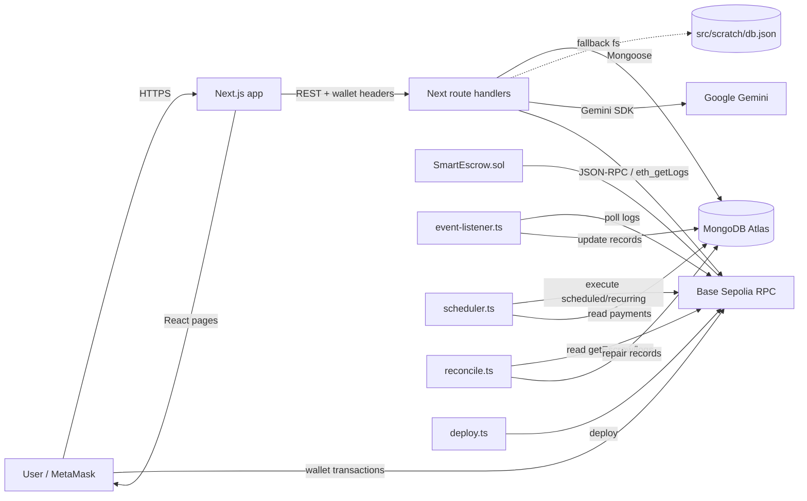
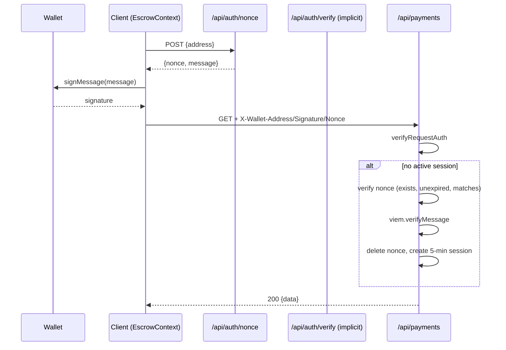

# SmartEscrow — Part 1: Overview, Stack, Architecture, Folder Map

> This guide is based on the source code in this repository, not on marketing copy.
> Where `README.md` disagrees with the code, the code is authoritative and the
> discrepancy is listed in Part 3, §12.5.

---

## 1. Project overview

### 1.1 What is this project?

SmartEscrow is a **Web3 escrow dApp** with an **AI-assisted payment setup flow**.

A user connects an Ethereum wallet, describes a payment in plain English
("Pay Alice 1.25 ETH when the landing page is deployed"), reviews the extracted
parameters, and confirms. The application then:

1. stores a payment record off-chain,
2. locks the funds in the `SmartEscrow` Solidity contract on **Base Sepolia**
   (chain ID `84532`),
3. links the database record to the on-chain escrow id emitted by the
   `EscrowCreated` event,
4. later releases or refunds the funds through contract calls.

A floating RAG chatbot answers questions about the platform using a PDF
knowledge base.

### 1.2 What problem does it solve?

Normal escrow (freelance platforms, solicitors, marketplaces) needs a trusted
intermediary, manual approvals, and days of settlement time. SmartEscrow
replaces the intermediary with a smart contract: the money is locked in code,
release is a transaction, and every movement is publicly verifiable.

The second problem is usability. Smart-contract interactions normally require
the user to understand ABI parameters, token decimals, and raw addresses. The
natural-language parser reduces that to a sentence plus a review screen.

### 1.3 Why was it developed?

The repository is structured as a college/portfolio project (comments such as
"acceptable for college project", a zero-cost testnet setup guide, and a
presentation-oriented README). Its purpose is to demonstrate, end to end:

- Solidity development and Hardhat testing,
- wallet connection and transaction signing,
- off-chain metadata storage with a graceful fallback,
- AI extraction with deterministic validation,
- event-driven synchronisation between chain and database,
- and a production-style Next.js interface.

### 1.4 Objectives

| Objective | Implementation |
|---|---|
| Non-custodial conditional payments | `SmartEscrow.sol` holds funds; no platform wallet custody |
| Natural-language input | `POST /api/parse-payment` (Gemini + rule fallback) |
| Multiple escrow behaviours | conditional, scheduled, recurring, NFT-conditional |
| Multi-token | ETH, USDC, USDT (address table in `src/lib/contracts.ts`) |
| Wallet-only authentication | nonce + signature, no passwords |
| Reliable chain↔DB linkage | event listener, reconciliation script, receipt decoding |
| Automated settlement | scheduler for scheduled/recurring escrows |
| Explainable UI | dashboard, detail timeline, toasts, transaction banners |
| Self-service help | RAG chatbot over `knowledge/smartescrow_knowledge.pdf` |

### 1.5 Intended users

- **Payers / clients** who want to lock funds against a deliverable.
- **Freelancers / receivers** who want proof that funds exist before starting.
- **Students/examiners** evaluating the architecture.
- In its current form it is **testnet-only** and has no production KYC,
  fiat on-ramp, dispute resolution, or receiver-side portal.

### 1.6 Real-world use cases

- Milestone-based freelance payouts.
- Prepaid bounties released when a PR is merged (verification is manual today).
- Subscriptions/salaries modelled as recurring escrows.
- NFT-gated delivery payments.
- Time-locked payments (vesting-like releases).

### 1.7 What makes it different / useful

- The full loop exists: parse → persist → lock → index event → release/refund →
  reconcile, not just a contract demo.
- It explains failures: wallet rejection, wrong network, missing contract,
  retry of persistence after a 401, reconciliation of stale records.
- Off-chain metadata is optional: MongoDB when configured, local JSON otherwise.
- The AI layer is **defensive**: Gemini output passes a manual validator and a
  Zod schema, and a rule-based parser takes over when the API key is missing or
  the AI call fails.

### 1.8 The project in plain language

Think of a **locker** (the smart contract). The payer puts money in the locker
and writes who may open it and under what conditions. The payer or a trusted
"oracle" address can open it for the receiver; after the deadline the payer can
take the money back. The website is a control panel around that locker, plus a
notebook (database) that remembers what each locker is for. The notebook can be
lost and rebuilt from chain events — that is what `scripts/reconcile.ts` does.

---

## 2. Technology stack

### 2.1 Stack table

| Layer | Technology | Version | Where used |
|---|---|---|---|
| Language | TypeScript | 5.x | entire app, scripts, tests |
| UI framework | Next.js (App Router) | 16.2.11 | `src/app/**`, route handlers |
| UI library | React | 19.2.4 | pages/components |
| Styling | Tailwind CSS v4 + PostCSS | 4.x | `globals.css`, class names |
| Icons | lucide-react | 1.72 | chatbot; custom `Icons.tsx` elsewhere |
| Wallet/Web3 | wagmi | 3.7.7 | connection, reads, writes |
| Low-level Web3 | viem | 2.56 | ABI decoding, signing verification, ENS |
| Async state | @tanstack/react-query | 5.102 | wagmi requirement |
| Wallet SDK | @coinbase/wallet-sdk | 4.4 | Coinbase Wallet connector |
| Contracts | Solidity | 0.8.20 | `contracts/SmartEscrow.sol` |
| Contract tooling | Hardhat | 3.15 | compile/deploy/test |
| Chain scripts | ethers | 6.17 | deploy, listener, scheduler, reconcile, seed |
| Database | MongoDB via Mongoose | 9.9 | optional persistence |
| DB fallback | Node `fs` JSON file | — | `src/scratch/db.json` |
| AI | @google/generative-ai | 0.24 | parsing + embeddings + answers |
| Validation | zod | 3.25 | parser output schema |
| PDF | pdf-parse | 2.4 | RAG ingestion |
| Env loading | dotenv | 17.4 | scripts/tests |
| Tests | Node test runner / Hardhat / Testing Library | — | `test/**` |
| Optional infra | Docker | — | disposable Mongo test container |

### 2.2 Why each technology

**Next.js 16 (App Router).** One deployable unit serves React pages and backend
route handlers (`src/app/api/**/route.ts`). File-system routing, server/client
boundaries, and `serverExternalPackages` for `pdf-parse` are used. Alternative:
separate Express/Nest backend + Vite React. This project is small, so one
codebase and one deployment are simpler; the trade-off is that long-running
background services must be hosted separately.

**React 19.** Component model for the dashboard and forms. `reactCompiler: true`
is enabled in `next.config.ts`. Alternative: Svelte/Vue; no technical blocker,
but the Web3 ecosystem's hooks (`wagmi`) are React-first.

**TypeScript.** The `Payment` shape, ABI arguments, and API contracts are shared
across client/server/scripts. This caught real bugs during development (e.g.
`updatePayment` returning `null`). Alternative: JavaScript, faster to start but
unsafe for ABI/address handling.

**Tailwind CSS v4.** Utility classes co-located with markup. No component
library; `src/components/Icons.tsx` supplies SVG icons. Alternative: shadcn/MUI
would add dependencies and design constraints.

**wagmi + viem.** `wagmi` gives React hooks for connect/read/write/receipt
(`useAccount`, `useWriteContract`, `useWaitForTransactionReceipt`,
`useBalance`, `useReadContract`). `viem` does the low-level work: ABI decode,
`parseUnits`, `verifyMessage`, ENS resolution. Alternative: ethers.js in the
browser. wagmi's typed hooks and React Query caching reduce boilerplate; ethers
is still used in Node scripts where its API is convenient.

**Solidity 0.8.20.** Built-in overflow checks, custom errors via `require`
strings, enums/structs/mappings. Alternative: Vyper (less tooling) or an
existing escrow protocol (less educational value, less control).

**Hardhat 3.** Compilation, local node, deployment, and the Node test runner
plugins. Alternative: Foundry (excellent, but the team chose the JS toolchain so
tests and app share TypeScript/viem).

**MongoDB + Mongoose.** Payments are documents with optional fields
(`contractEscrowId`, hashes, dates). A document store fits that shape and Atlas
offers a free tier. The JSON fallback keeps the project runnable with zero
setup. Alternative: PostgreSQL would be better for relational invariants, but
there is only one entity today and no joins.

**Gemini (`gemini-2.5-flash`) + `gemini-embedding-001`.** Used for three jobs:
natural-language extraction, embeddings for the knowledge base, and answer
generation. A deterministic rule parser is the fallback. Alternative: OpenAI
(paid key), local LLM (heavy), or regex-only (poor recall).

**Zod.** Second validation pass over AI output so a hallucinated field cannot
reach the contract call. Alternative: manual checks only, which already exist,
but Zod gives strict enums/limits with less code.

**pdf-parse.** Extracts text from the knowledge PDF at indexing time. It is
declared as a server external package so Next does not try to bundle its worker.

**Node test runner + tsx.** The API/security/db/chatbot tests import route
handlers directly and run with `tsx`, avoiding a live server. Hardhat uses its
own runner for Solidity/E2E.

### 2.3 What breaks if a technology is removed

| Removed | Consequence |
|---|---|
| Next.js | No routing, API, or SSR shell; would need a separate backend |
| wagmi/viem | No wallet connection, signing, or chain reads/writes |
| Smart contract | No custody; "escrow" becomes a database label |
| MongoDB | Falls back to JSON (fine locally, unsafe for concurrent/serverless use) |
| JSON fallback | App requires Mongo to start |
| Gemini | Parser falls back to regex; chatbot is unavailable (503) |
| pdf-parse/vector store | Chatbot reports an empty knowledge base |
| zod | Manual validation still runs, but weaker guarantees |
| Hardhat | No compile/deploy/test pipeline for Solidity |

---

## 3. Architecture

### 3.1 System context



### 3.2 Layers

**Presentation (client components).** `src/app/(public)` and
`src/app/(dashboard)`, plus `src/components`. All wallet state is client-side.
The dashboard layout wraps children in `EscrowProvider`, which wraps the whole
app in `Web3Provider` + `ToastProvider` at the root.

**HTTP/API layer.** Next route handlers in `src/app/api`. They are stateless
except for the in-memory auth stores in `src/lib/auth.ts`. They validate input,
authenticate wallet headers, and call `src/lib/db.ts`.

**Domain/service layer.**
- `src/lib/db.ts` — storage abstraction with two backends.
- `src/lib/auth.ts` — nonce/session/signature verification.
- `src/hooks/useEscrowContract.ts` — all contract writes and receipt waiting.
- `src/lib/rag/*` — retrieval-augmented generation pipeline.
- `src/lib/escrowEvents.ts` — receipt log → escrow id decoding.

**Chain layer.** `contracts/SmartEscrow.sol`, deployed once. It stores escrows
in a mapping and emits three events used by the app.

**Off-chain workers.** `scripts/event-listener.ts`, `scripts/scheduler.ts`,
`scripts/reconcile.ts`, `scripts/seed-mongo.ts`.

### 3.3 Trust boundaries

1. **Browser ↔ API.** The browser is untrusted. Every payment write derives the
   sender from a verified signature, never from the body.
2. **API ↔ database.** Trusted service credentials (`MONGODB_URI`).
3. **Browser ↔ chain.** The user signs with their own key; the app never sees it.
4. **Workers ↔ chain.** The scheduler signs with `DEPLOYER_PRIVATE_KEY`, which
   is also the contract's oracle/executor in the current deployment.
5. **AI output.** Untrusted; validated twice before use.

### 3.4 Authentication architecture



Note: there is no separate call to `/api/auth/verify` in the client flow. That
route exists and is tested, but `verifyRequestAuth` performs verification lazily
on the first authenticated API request and creates the session itself.

### 3.5 API architecture

Seven route groups: auth (2), payments, parser, events, chatbot, and two
retrieval test routes. They are documented in Part 2, §8.

### 3.6 Background architecture

- **Event listener** polls every 12 s from the current head; keeps an in-memory
  `Set` of `txHash-logIndex`; updates records by `contractEscrowId`.
- **Scheduler** polls every 30 s, reads active scheduled/recurring payments, and
  sends `executeScheduledRelease` / `executeRecurringPayout`.
- **Reconcile** is the repair tool: it reads chain state, resolves missing ids
  from receipts or a bounded event search, and corrects DB fields.
- **Seed** copies local JSON payments into MongoDB idempotently.

### 3.7 Data architecture

One collection, `payments`, keyed by an application `id` (`pay_<uuid>`) with a
unique index. On-chain escrow ids are stored as `contractEscrowId`. There are no
foreign keys; the chain is the external system of record for money.

### 3.8 Full request path (summary)

1. Browser loads a page; root layout mounts Web3/Toast providers.
2. Dashboard layout mounts `EscrowProvider`.
3. `refreshPayments` runs. If a wallet is connected, it obtains a nonce, signs,
   and calls `GET /api/payments`.
4. Route verifies headers; `getPaymentsBySender` queries Mongo/JSON; JSON is
   returned; context stores it.
5. A create action calls `POST /api/payments` (pending), then sends the wallet
   transaction, then `PATCH`es the linkage.
6. Release/refund sends a wallet transaction, waits for the receipt, then
   `PATCH`es the final status.
7. Workers independently observe the same events and update the database.

A detailed step-by-step flow with diagrams is in Part 2, §6.

---

## 4. Folder structure

```
.
├── contracts/
│   ├── SmartEscrow.sol        main escrow contract (4 creation modes)
│   └── MockToken.sol          unrestricted test ERC-20 (testnet only)
├── scripts/
│   ├── deploy.ts              preflight + deploy + write address to .env.local
│   ├── event-listener.ts      poll logs, sync status/linkage to DB
│   ├── scheduler.ts           execute due scheduled/recurring escrows
│   ├── reconcile.ts           chain→DB repair (id recovery, status correction)
│   ├── seed-mongo.ts          JSON→Mongo import (idempotent)
│   └── run-mongo-tests.mjs    disposable Docker Mongo for tests
├── src/
│   ├── app/
│   │   ├── layout.tsx         html shell, providers, floating chatbot
│   │   ├── globals.css        Tailwind + design tokens/utility classes
│   │   ├── (public)/          landing + about (Navbar/Footer)
│   │   ├── (dashboard)/       sidebar + topbar; mounts EscrowProvider
│   │   └── api/               route handlers (auth, payments, parser, events, RAG)
│   ├── components/            presentational + interactive UI
│   ├── context/
│   │   ├── Web3Provider.tsx   wagmi config (Base Sepolia + localhost)
│   │   ├── EscrowContext.tsx  payments, auth headers, API calls, metrics
│   │   └── ToastContext.tsx   global notifications
│   ├── hooks/
│   │   ├── useEscrowContract.ts  create/release/refund/scheduled/recurring
│   │   └── useENS.ts             address or .eth resolution
│   ├── lib/
│   │   ├── auth.ts            nonce/session/signature verification
│   │   ├── contracts.ts       ABIs + token addresses + chain id
│   │   ├── db.ts              Mongo/JSON storage abstraction
│   │   ├── escrowEvents.ts    EscrowCreated decoding
│   │   ├── mockData.ts        demo payments + fake USD prices
│   │   └── rag/               PDF→chunks→embeddings→retrieval→answer
│   ├── types/payment.ts       shared domain types
│   └── scratch/db.json        runtime JSON DB (gitignored)
├── test/                      8 suites (contract, e2e, security, API, DB, chatbot)
├── knowledge/smartescrow_knowledge.pdf   chatbot corpus
├── data/smartescrow-vectors.json         generated embeddings (gitignored)
├── hardhat.config.ts           Solidity 0.8.20, Base Sepolia/localhost
├── next.config.ts              React Compiler, pdf-parse external
├── tsconfig.json               strict, `@/*` path alias, excludes scripts/tests
├── eslint.config.mjs           Next core-web-vitals + TS, ignores scripts/tests
├── postcss.config.mjs          Tailwind PostCSS plugin
├── .env.example                documented template
├── .env.local                  real secrets (gitignored)
└── package.json                scripts and dependencies
```

### 4.1 Important files and why they matter

| File | Purpose | Depends on / used by |
|---|---|---|
| `contracts/SmartEscrow.sol` | Custody + release rules | deploy, listener, hooks, scheduler, reconcile |
| `src/lib/contracts.ts` | ABI/token addresses shared by client and scripts | hooks, event decoding |
| `src/lib/db.ts` | Only storage entry point | API routes, workers, tests |
| `src/lib/auth.ts` | Identity for every protected route | payments/events routes, tests |
| `src/hooks/useEscrowContract.ts` | All wallet writes + receipts | create page, detail page |
| `src/context/EscrowContext.tsx` | Client cache + authenticated fetch | dashboard pages, detail page |
| `src/app/api/payments/route.ts` | CRUD contract for records | context, create/detail pages |
| `src/app/api/parse-payment/route.ts` | NL→parameters | create page |
| `src/lib/rag/generateAnswer.ts` | Question→answer | chatbot route |
| `scripts/reconcile.ts` | Repairs bookkeeping drift | ops/manual |
| `scripts/scheduler.ts` | Automates time-based releases | ops |
| `test/*` | Evidence of behaviour | CI/manual |

### 4.2 Configuration files

- `next.config.ts`: `reactCompiler: true`, `serverExternalPackages: ["pdf-parse"]`.
- `hardhat.config.ts`: loads `.env.local`, network `baseSepolia` (84532) and
  `localhost`, optimizer 200 runs, paths for contracts/tests/artifacts.
- `tsconfig.json`: `strict`, path alias `@/*`, `noEmit`; **scripts and tests are
  excluded**, so `npx tsc --noEmit` does not typecheck them.
- `eslint.config.mjs`: Next presets; ignores `scripts/**` and `test/**`.
- `.env.example`: documented variables; `.env.local` is gitignored.
- `.gitignore`: ignores `.env*` except `.env.example`, `src/scratch/db.json`,
  `data/` (vector store), Hardhat artifacts/cache.

---

Continue with **Part 2** for components, flows, database, API, and key code.
