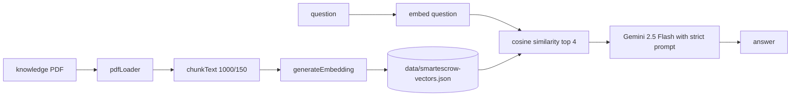
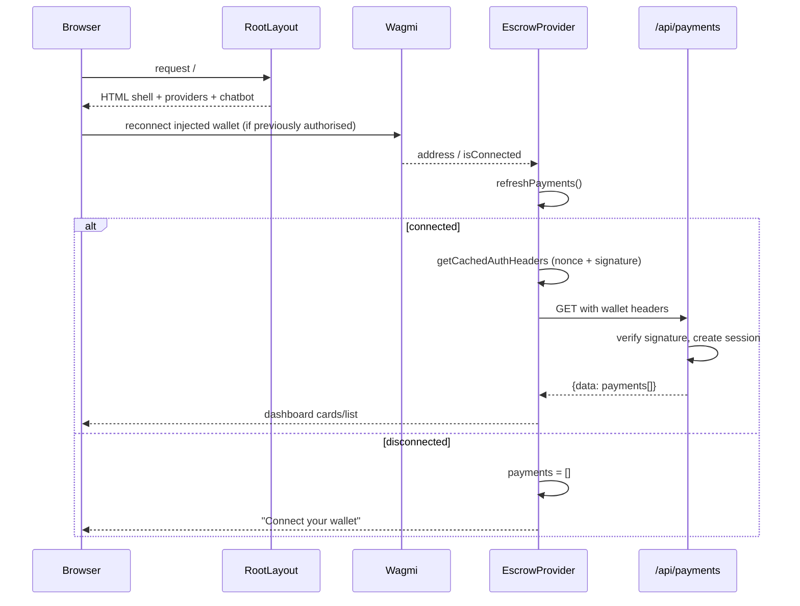
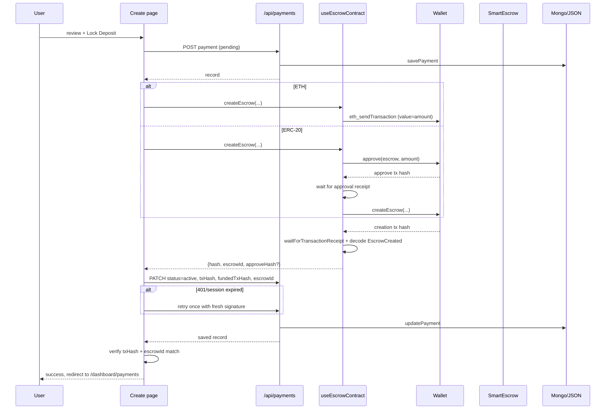
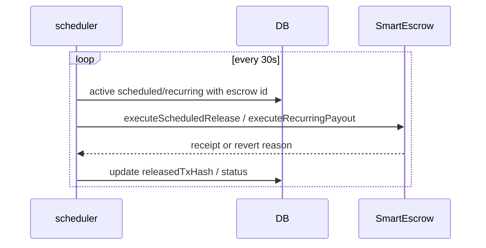
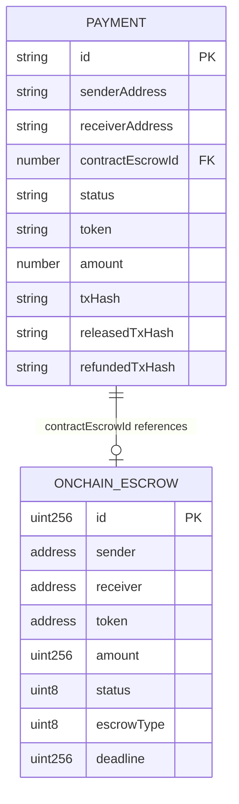

# SmartEscrow — Part 2: Components, Flows, Database, API, Key Code

---

## 5. Component-by-component

### 5.1 App shell and layouts

**`src/app/layout.tsx` (root, server component)**
- Sets metadata and wraps every page in `Web3Provider` → `ToastProvider`.
- Renders `<Chatbot />` globally, so the assistant is available on public and
  dashboard pages.
- Input: `children`. Output: `<html><body>` shell.
- If removed: no wallet context, toasts, fonts, or global styles.

**`src/app/(public)/layout.tsx`**
- Adds `Navbar` and `Footer` around landing/about pages.
- It is a route group, so URLs remain `/` and `/about`.

**`src/app/(dashboard)/layout.tsx` (client)**
- Wraps the console in `EscrowProvider` (payments state + authenticated fetch).
- Renders `Sidebar` (desktop fixed, mobile drawer), a sticky topbar with
  `WalletWidget`, and the content area.
- Uses `useAccount` only for sidebar status; the provider owns data fetching.

### 5.2 Pages

**Landing `/`** (`src/app/(public)/page.tsx`)
- Marketing composition: `HeroSection`, `FeatureCards`, "How it works",
  benefits, CTA.
- The hero contains a **simulated** typing/parsing animation using
  `SIMULATION_STEPS`; it is not calling the API.
- Claims such as "5+ supported chains" and "audited" are marketing text and are
  **not** implemented/verified (see Part 3 §12.5).

**About `/about`**
- Static principles, lifecycle cards, and a four-phase roadmap marked complete.
- No data fetching.

**Dashboard `/dashboard`**
- Reads `displayPayments`, `metrics`, `walletConnected`, `showSampleData` from
  `EscrowContext`.
- Live balances: `useBalance` for the connected wallet and for the escrow
  contract address, both pinned to Base Sepolia (`chainId: baseSepolia.id`).
  Formatting uses `formatUnits`, max 6 decimals; shows `—` while loading.
- Four metric cards: balances, active count, completed count, wallet status.
- Client-side status filter; list renders `PaymentCard`.
- Empty states: "connect wallet" when disconnected (unless sample mode), or
  "no agreements".
- The right column includes "Event Stream" entries that are **hardcoded demo
  text**, not live events.

**Create payment `/dashboard/create-payment`** (the most complex page)
- Tabs: natural-language parser and manual configuration.
- NL flow: `POST /api/parse-payment` → fills form fields → switches to manual
  tab for review. `mock: true` means the rule-based fallback was used.
- Manual fields: name, address/ENS, amount, token, type, duration, scheduled
  date, recurring interval, NFT contract/token id, description, condition.
- Validation: HTML `required`, `handleProceedToReview` requires the four core
  fields and resolves `.eth` via `useENS` before continuing.
- Review step renders `PaymentReview`, which shows the summary and transaction
  status. Confirmation runs `handleConfirmPayment` (see §6.3).
- Contract-not-deployed warning comes from
  `NEXT_PUBLIC_SMART_ESCROW_ADDRESS` being empty.
- On success: success banner then redirect to `/dashboard/payments` after 2 s.

**Payments list `/dashboard/payments`**
- Requires a connected wallet to render (client check).
- Client-side filters: status, type (`conditional`/`scheduled`/`recurring` only,
  so NFT-conditional is not selectable), and text search over name, description,
  condition.
- Sample-data banner and badges when `showSampleData` is on.

**Payment detail `/dashboard/payments/[id]`**
- Finds the record in the context array by URL id (no server fetch).
- Shows status, parameters, condition, original prompt, and a transaction
  timeline (created/deposit/funding/release/refund/status).
- Release: `releaseEscrow(escrowId)` → wait for receipt → PATCH `completed` with
  `releasedTxHash` and `releaseDate`.
- Refund: `refundEscrow` → wait → PATCH `cancelled` with `refundedTxHash`.
- Important: contract rules still apply (sender refund only after deadline;
  sender or oracle release).
- If the PATCH fails after a successful chain transaction, the UI shows an
  error; the chain is already settled. Reconciliation can repair the record.
- Buttons show only for `active`.

**History `/dashboard/history`**
- Table of all payments, search by name/id/description, status filter.
- Sorts newest first client-side.
- Labels `cancelled` as **Refunded** (the app's chosen display convention).
- `refunded` status, although allowed by the API, would fall into the default
  "Pending" badge here — a UI inconsistency.

**Profile `/dashboard/profile`**
- Wallet address, short id, chain name, balance, disconnect.
- Counts from `payments` (total/active/completed/cancelled).
- Displays `metrics.totalPaymentsVolume` as **Total Volume (USD)**. That value
  multiplies amounts by hardcoded `TOKEN_PRICES` (`ETH: 3400`), so it is an
  estimate, not a market price.

### 5.3 Shared components

| Component | Purpose | Inputs | Notes / failure impact |
|---|---|---|---|
| `PaymentCard` | Escrow summary card | `payment`, `isSample` | Status styling; buttons are links to detail, not direct calls |
| `PaymentReview` | Final confirmation | all payment fields, tx state, callbacks | Disables actions while processing; shows error and tx banner |
| `TxStatusBanner` | Transaction progress | `txState`, `txHash`, `step` | Distinguishes approve vs escrow step; links to Basescan |
| `ToastContext` | Global notifications | `toast({title,description,variant,href})` | Max 3 visible (keeps last 2 + new), auto-dismiss 5 s |
| `WalletWidget` | Connect/switch/disconnect | internal wagmi | Handles missing extension, rejected connection, wrong network |
| `Sidebar` | Console navigation | wallet props, open state | Active-link logic; mobile overlay |
| `Navbar`/`Footer` | Public shell | none | Static links |
| `HeroSection` | Animated demo | none | Typing loop with timers; purely illustrative |
| `FeatureCards` | Feature grid | none | Static marketing |
| `Chatbot` | Floating RAG UI | none | Message list, loading, retry, error display; 420×300 panel |

### 5.4 Context providers

**`Web3Provider`**
- `createConfig` with chains `[baseSepolia, localhost]`, connectors
  `injected()` and `coinbaseWallet({appName})`, transports `http(...)`.
- `ssr: true`; a single module-level `QueryClient`.
- Only Base Sepolia is the product target; `localhost` exists for local Hardhat
  development, though `useEscrowContract` does not pass a `chainId`.

**`EscrowContext`**
- State: `payments`, `isLoading`, `isInitialized`, `showSampleData`; an auth
  header cache (`authCacheRef`, 4-minute TTL).
- `getCachedAuthHeaders`: requests `/api/auth/nonce`, signs with
  `useSignMessage`, returns the three headers. Reused for 4 minutes.
- `authorizedFetch`: attaches headers and retries once on `401` after clearing
  the cache (handles server restart/expired session).
- `refreshPayments`: `GET /api/payments`; on failure clears local payments.
- `addPayment`: optimistic insert → `POST`; rolls back on failure and rethrows.
- `updatePayment`: awaits `PATCH`, throws on non-OK, then merges the server
  response into state. Returns the saved record.
- `triggerRelease` / `cancelPayment`: older optimistic helpers that only PATCH
  status (no chain call). They are **not referenced anywhere** in the current
  UI; the detail page performs chain + DB itself.
- Metrics: active includes `pending`; completed counts `completed`; volume is
  the fake-USD estimate described above.
- `displayPayments` switches between real payments and `MOCK_PAYMENTS`; sample
  data is opt-in and never merged.

**`ToastContext`**
- Provides `toast`; renders accessible live region; variants pending/success/
  error; optional Basescan link.

### 5.5 Hooks

**`useEscrowContract`** — the write layer.
- Constants: escrow address from `NEXT_PUBLIC_SMART_ESCROW_ADDRESS`; token
  address/decimals helpers.
- State: `txState` (`idle|preparing|wallet-pending|confirming|confirmed|failed`),
  `txHash`, `txStep` (`approve|escrow|null`), `error`.
- Receipt: `useWaitForTransactionReceipt`; `escrowId` is derived from receipt
  logs with `extractEscrowIdFromLogs`.
- `createEscrow` / `createScheduledEscrow` / `createRecurringEscrow` /
  `createNFTConditionalEscrow`: build `parseUnits(amount, decimals)`, send ETH
  with `value` or for ERC-20 approve exact amount → wait for approval →
  create → wait for creation → return `{hash, escrowId, approveHash?}`.
- `releaseEscrow`, `refundEscrow`, `resolveEscrow`, `executeScheduledRelease`,
  `executeRecurringPayout`: send the corresponding contract call.
- `waitForTransaction`: used by the detail page before persisting status.
- `parseWalletError`: maps common wallet/contract errors to actionable text.
- Two toasts are emitted (submitted, confirmed) with dedupe refs; approval
  receipt does not trigger a false "confirmed" toast.
- `useTokenBalance`: `balanceOf` read helper (defined but currently unused).
- Failure: throws to caller after setting `error`/`failed`; the page decides
  what to display.

**`useENS`**
- Accepts `0x…` (length 42) directly; otherwise requires `.eth`, resolves with
  `publicClient.getEnsAddress`, tracks resolving/error.
- Runs on the currently connected chain. ENS resolution on Base Sepolia is not
  guaranteed; failures are surfaced, not hidden.

### 5.6 Library modules

**`src/lib/contracts.ts`** — `SMART_ESCROW_ABI`, `ERC20_ABI`, `ERC721_ABI`,
`MOCK_TOKEN_ABI`, `BASE_SEPOLIA_CHAIN_ID = 84532`, token addresses:
- USDC `0x036CbD53842c5426634e7929541eC2318f3dCF7e` (6 decimals)
- USDT `0xf11838B60C0EBf7B2781B7e9A06a5d18B68e3E3e` (6 decimals)
- WETH `0x4200000000000000000000000000000000000006` (18 decimals)
Note: the README's USDC address table is outdated; the code value is the one
used at runtime.

**`src/lib/escrowEvents.ts`**
- `extractEscrowIdFromLogs(logs)` decodes every log with
  `decodeEventLog({abi: SMART_ESCROW_ABI})`, ignores non-matching logs, and
  returns the first `EscrowCreated.id` as a number, or `null`.
- Shared by the write hook and the E2E test, so both exercise the same logic.

**`src/lib/mockData.ts`**
- Six demo payments with a dummy sender and `TOKEN_PRICES` / mock balances.
- Used only when the user enables sample data; metrics never use it.

**`src/lib/db.ts`** — storage abstraction; detailed in §7.

**`src/lib/auth.ts`** — identity; detailed in Part 3 §9 and §10.

**`src/lib/rag/*`** — RAG pipeline; detailed in §5.8.

### 5.7 Smart contract

`contracts/SmartEscrow.sol` (316 lines):

- `enum EscrowStatus { Active, Completed, Refunded }`
- `enum EscrowType { Conditional, Scheduled, Recurring }`
- `struct Escrow { id, sender, receiver, token, amount, condition, deadline,
  status, escrowType, interval, conditionTarget, conditionTokenId }`
- Storage: `nextEscrowId`, `oracle`, `executor`, `escrows` mapping,
  `lastRecurringExecution`.
- Events: `EscrowCreated(id indexed, sender indexed, receiver indexed, token,
  amount, condition, deadline)`, `EscrowReleased(id indexed, receiver, amount)`,
  `EscrowRefunded(id indexed, sender, amount)`, `OracleUpdated`,
  `ExecutorUpdated`.
- `constructor(oracle)` requires non-zero, sets `executor = oracle`, initialises
  the reentrancy guard.
- Creation functions all call `_createEscrowInternal`, which validates
  receiver/non-zero, receiver != sender, amount > 0; sets
  `deadline = duration > 0 ? now + duration : now + 365 days`; for ETH requires
  `msg.value == amount`; for ERC-20 requires `msg.value == 0` and
  `transferFrom(sender, contract, amount)`; stores the escrow and emits.
- `release(id)`: Active only; **sender or oracle**; calls `_releaseEscrow`.
- `refund(id)`: Active only; **oracle anytime**, **sender only after deadline**,
  others revert; calls `_refundEscrow`.
- `resolveEscrow(id, release)`: oracle only; release or refund.
- `executeScheduledRelease(id)`: executor or oracle; type Scheduled; now >=
  deadline; release.
- `executeRecurringPayout(id)`: executor or oracle; type Recurring; first payout
  any time, later ones only after `interval`; requires now < deadline; records
  `lastRecurringExecution`; pays `escrow.amount` every time (see limitation).
- `verifyNFTCondition(id)`: view; returns `ownerOf(tokenId) == receiver`; only
  used if the oracle chooses to call it. `release` does not call it.
- `_releaseEscrow` / `_refundEscrow`: set status **before** external transfer
  (checks-effects-interactions), then transfer ETH via `call` or ERC-20
  `transfer`, then emit.
- `getEscrow(id)` returns the struct (zeroed for unknown ids).
- `updateOracle` / `updateExecutor`: oracle only, non-zero.

### 5.8 RAG subsystem

Files: `errors.ts`, `chunker.ts`, `embeddings.ts`, `pdfLoader.ts`,
`vectorStore.ts` (duplicate `vector.ts`), `indexer.ts`, `retrieval.ts`,
`generateAnswer.ts`.

Pipeline:



- `chunkText` slides a 1000-character window with 150-character overlap; trims
  empty chunks; throws if overlap >= size.
- `generateEmbedding` requires `GEMINI_API_KEY`, uses `gemini-embedding-001`.
- `loadPDF` reads `knowledge/smartescrow_knowledge.pdf` with `pdf-parse` and
  destroys the parser.
- `retrieveRelevantChunks` loads the JSON store, throws `EMPTY_KNOWLEDGE_BASE`
  if empty, embeds the question, computes cosine similarity, returns top 4.
- `generateAnswer` builds a context-only prompt with rules: beginner-friendly,
  no invention, refuse if unknown, never claim live balances, never ask for
  secrets.
- **Indexing gap:** `indexPDF()` exists but has no npm script and no route.
  `/api/index-pdf` is misnamed — it only runs retrieval for a fixed question,
  exactly like `/api/test-pdf`. The checked-in workspace has a generated store
  (36 chunks, 3072 dimensions), but `data/` is gitignored, so a fresh clone
  needs manual indexing.
- Chatbot routes have no authentication or rate limiting.

### 5.9 Workers and operations scripts

| Script | Trigger | Behaviour | Limits |
|---|---|---|---|
| `deploy.ts` | manual | validates key, checks gas, deploys, writes address to `.env.local` | needs funded key |
| `event-listener.ts` | long-running | poll new logs every 12 s; create→active, release→completed, refund→cancelled; dedupe in memory | misses events before start; no backfill; recurring issue |
| `scheduler.ts` | long-running | every 30 s execute due scheduled/recurring; `--dry-run` lists candidates offline | signed by deployer key; doesn't check `scheduledAt` itself (chain does) |
| `reconcile.ts` | manual/cron | chain→DB repair; dry-run; refuses local fallback when Mongo configured | bounded log window |
| `seed-mongo.ts` | manual | JSON→Mongo, `$setOnInsert`, `--dry-run` | never overwrites |
| `run-mongo-tests.mjs` | `npm run test:db:mongo:docker` | starts disposable `mongo:7`, runs tests, always cleans up | requires Docker |

---

## 6. Complete working flow

### 6.1 App start and initial load



Key detail: the first authenticated request performs verification; there is no
separate login screen. Signing is free and sends no transaction.

### 6.2 Natural-language parsing

1. User types/pastes a sentence and clicks **Extract Parameters**.
2. `handleNLParse` calls `POST /api/parse-payment`.
3. If `GEMINI_API_KEY` exists, Gemini is called with a JSON response schema. If
   the call throws (quota, network, bad JSON), the catch block runs the
   rule-based parser and returns `mock: true` with a warning.
4. The raw object passes `validateParsedData` (manual: lengths, positive amount,
   token/type enums, address/ENS regex) and then `zodValidate`.
5. Errors are returned in `validationErrors`; the UI fills the form regardless,
   then requires the user to review.
6. The parser only returns `conditional|scheduled|recurring`; NFT-conditional
   must be configured manually. Gemini's schema has no `scheduledAt` field, so
   dates come from the rule fallback (or the user).

### 6.3 Creating an escrow (happy path)



Failure semantics:
- If `POST` fails: optimistic record is rolled back, nothing on-chain.
- If the wallet rejects: DB record stays `pending` (no tx hash), error is shown.
- If the transaction reverts: record stays `pending`; `txError` is shown.
- If the session dies after the chain tx: `authorizedFetch` retries once; the
  page also retries once; if still failing, it throws a message that includes
  the tx hash and payment id and tells the user not to re-create the escrow.
  `scripts/reconcile.ts` can later repair the record.

### 6.4 Release and refund

```mermaid
sequenceDiagram
    participant U as User
    participant D as Detail page
    participant H as useEscrowContract
    participant C as SmartEscrow
    participant API as /api/payments
    U->>D: Release Funds
    D->>H: releaseEscrow(escrowId)
    H->>C: release(id)
    C->>C: require Active; sender or oracle
    C-->>H: receipt + EscrowReleased
    H-->>D: hash
    D->>D: waitForTransaction(hash), check status
    D->>API: PATCH completed + releasedTxHash + date
    API-->>D: updated record
    D-->>U: status completed
```

Refund is identical but calls `refund(id)` and patches `cancelled` +
`refundedTxHash`. Contract rules: oracle anytime; sender only after deadline.
The listener may update the same record independently; updates are idempotent.

### 6.5 Scheduled and recurring automation



Contract enforces timing. The scheduler's `--dry-run` needs no key or RPC and
lists candidates. The event listener also observes `EscrowReleased` and updates
by escrow id.

Important recurring semantics: the contract pays `escrow.amount` on every
payout but was funded once. It also emits `EscrowReleased` each time, which the
listener interprets as final completion. These are real limitations, covered in
Part 3 §12.

### 6.6 Reconciliation flow

1. Read payments (Mongo required if configured; aborts otherwise).
2. Resolve escrow id: stored id → creation/settlement receipt → bounded
   `EscrowCreated` search around `createdAt` (200-block chunks, 6 h window).
3. `getEscrow(id)`; reject zero sender; enforce sender match.
4. Map status; build only changed fields; fill tx hash/block/date when available.
5. Dry-run reports; apply writes via `updatePayment`; a second run is a no-op.

### 6.7 Chatbot flow

Widget → `POST /api/chatbot` → load vector store (503 if empty) → embed question
→ cosine top 4 → prompt Gemini with context → return answer → widget renders.
Errors are shown in-chat with a Retry button that does not duplicate the user
message.

---

## 7. Database

### 7.1 Why this database

Only one entity exists, with many optional fields and no joins. MongoDB stores
that shape naturally, and Atlas has a free tier. The JSON fallback removes the
setup barrier for a demo. A relational database would be preferable if users,
receivers, disputes, and audit tables were added.

### 7.2 Collection `payments`

| Field | Type | Required | Purpose |
|---|---|---|---|
| `_id` | ObjectId (Mongo) | auto | storage id; not used by the app |
| `id` | string | yes, unique | app id `pay_<uuid>`; API key |
| `senderAddress` | string | yes | wallet that owns the record; lowercased |
| `receiverName` | string | yes | display name |
| `receiverAddress` | string | yes | payout address; lowercased |
| `amount` | number | yes | human units (not wei) |
| `token` | string | yes | ETH / USDC / USDT |
| `type` | string | yes | conditional / scheduled / recurring / nft-conditional |
| `status` | string | yes | pending / active / completed / cancelled / refunded / failed |
| `condition` | string | yes | release text (also stored on-chain) |
| `createdAt` | ISO string | yes | creation timestamp |
| `releaseDate` | ISO string | no | settlement/refund timestamp |
| `description` | string | no | memo |
| `naturalLanguagePrompt` | string | no | original user sentence |
| `contractEscrowId` | number | no | on-chain id |
| `txHash` | string | no | escrow creation transaction |
| `fundedTxHash` | string | no | ERC-20 approval transaction |
| `releasedTxHash` | string | no | successful release |
| `refundedTxHash` | string | no | successful refund |
| `blockNumber` | number | no | creation block |
| `duration` | number | no | seconds |
| `scheduledAt` | ISO string | no | requested schedule (UI/display) |
| `frequency` | string | no | daily/weekly/monthly/quarterly |

### 7.3 Indexes

From the Mongoose schema:

- `id` unique — prevents duplicate application ids.
- `senderAddress` — every list query filters on it.
- `type`, `status` — common filters (the app currently filters client-side).
- `contractEscrowId` sparse — listener/reconcile lookups.

### 7.4 Relationships / ER diagram

There is a single persisted entity. The chain is an external system of record;
`contractEscrowId` is a soft reference to an on-chain struct, not a database FK.



### 7.5 Validation

- API checks required fields, address regex, positive amount, token/type enums,
  scheduled/recurring extras.
- Mongoose enforces required fields, `id` uniqueness, and types.
- The JSON backend performs **no schema validation**; it trusts the caller.
- On-chain validation is independent (receiver, amount, value, status, access).

### 7.6 CRUD and queries

| Operation | Function | Backend behaviour |
|---|---|---|
| Create | `savePayment` | Mongo: returns existing if id exists, else insert; JSON: unshift if id absent |
| Read all for wallet | `getPaymentsBySender` | Mongo: `find({senderAddress: lower})`; JSON: case-insensitive filter |
| Read one | `getPaymentById` | exact id |
| Update | `updatePayment` | Mongo: `findOneAndUpdate({id}, {$set: pickUpdates}, after)`; JSON: map + write |
| Update by escrow | `updatePaymentByEscrowId` | matches `contractEscrowId`; used by listener |
| Delete | none | no API/script deletes payments |

`pickUpdates` whitelists only status, dates, hashes, block number, escrow id and
ignores `undefined`, so callers cannot clear a field through this path.

### 7.7 JSON fallback details

- Path: `src/scratch/db.json` (or `LOCAL_DB_PATH`).
- Created on first read/write with `[]`.
- Entire file is read and rewritten synchronously per operation. This is fine
  for a single local process, **not** for concurrent serverless instances:
  lost updates are possible, and writes are not atomic.
- If Mongo is configured but unreachable, the default behaviour is to log and
  fall back. The reconciliation script opts into **fail-loud** mode instead.

---

## 8. API reference

All protected routes expect:

```
X-Wallet-Address: 0x...
X-Wallet-Signature: 0x...
X-Wallet-Nonce: 0x...
```

### 8.1 Auth

| Method | Path | Body | Success | Errors |
|---|---|---|---|---|
| POST | `/api/auth/nonce` | `{address}` | 200 `{nonce, message}` | 400 invalid/missing; 500 |
| POST | `/api/auth/verify` | `{address, signature, nonce}` | 200 `{verified:true, address}` | 400 missing; 401 bad signature; 500 |

Nonce: 32 random hex chars, stored per address, 5-minute expiry, single use.
Session: keyed by `address:nonce`, 5-minute expiry.

### 8.2 Payments

| Method | Path | Auth | Body | Success | Errors |
|---|---|---|---|---|---|
| GET | `/api/payments` | yes | — | 200 `{data:[Payment]}` | 401; 500 |
| POST | `/api/payments` | yes | payment fields | 200 `{success, data}` | 400 validation; 401; 500 |
| PATCH | `/api/payments` | yes | `{id,status,...}` | 200 `{success,data}` | 400; 401; 403 not owner; 404; 500 |

POST validation: receiver name/address present; address regex; positive amount;
token in ETH/USDC/USDT; type in the four types; scheduled requires
`scheduledAt`; recurring requires `frequency`. The server overwrites
`senderAddress` with the authenticated wallet and lowercases both addresses.

PATCH requires `id` and `status`; validates status; loads the record and requires
`senderAddress === authenticated address`; updates the whitelisted fields.

**Gaps to know:** POST accepts a client-supplied `id`, `status`, and
`createdAt`, and spreads all extra fields into the stored document. An
authenticated user could therefore seed a record as `completed` or reuse an id.
PATCH's ownership check prevents modifying someone else's record, but GET only
returns payments where the wallet is the **sender**; receivers have no view.

### 8.3 Parser

| Method | Path | Auth | Body | Success | Errors |
|---|---|---|---|---|---|
| POST | `/api/parse-payment` | no | `{prompt}` | 200 `{data, mock, validationErrors?}` | 400 invalid prompt; 500 only if fallback also fails |

The response `data` shape: `receiverName`, `receiverAddress` (address, ENS, or
`""`), `amount` number, `token`, `type`, `condition`, `description`, and
optionally `scheduledAt`/`frequency` from the rule parser.

### 8.4 Events

| Method | Path | Auth | Success | Errors |
|---|---|---|---|---|
| GET | `/api/events` | yes | 200 `{success, contractAddress, currentBlock, contractBalanceWei, network, chainId, events, eventsFromBlock}` | 401; 503 contract not configured; 500 |

It queries the last 10,000 blocks with raw JSON-RPC `eth_getLogs`. On the public
Base Sepolia RPC, `eth_getLogs` is limited to a **200-block range**; a 10,000
block request fails and the catch block returns `events: []` with the basic
balance fields. Use a provider that supports the range, or reduce it.

### 8.5 Chatbot / retrieval

| Method | Path | Auth | Body | Success | Errors |
|---|---|---|---|---|---|
| POST | `/api/chatbot` | no | `{question}` | 200 `{success, question, answer}` | 400 empty/non-string; 503 `MISSING_API_KEY`/`EMPTY_KNOWLEDGE_BASE`; 500 |
| GET | `/api/index-pdf` | no | — | 200 retrieval results for a fixed question | 500 |
| GET | `/api/test-pdf` | no | — | same as above | 500 |

`/api/index-pdf` does **not** index; it is a duplicate retrieval check. No route
or npm script calls `indexPDF()`.

### 8.6 Which frontend calls what

| UI action | API |
|---|---|
| App/dashboard load, refresh | `GET /api/payments` |
| Create step 1 | `POST /api/payments` |
| Create step 3 | `PATCH /api/payments` |
| Detail release/refund | `PATCH /api/payments` (+ wallet tx) |
| NL extract | `POST /api/parse-payment` |
| Chatbot send | `POST /api/chatbot` |
| No current UI | `/api/events`, `/api/auth/verify`, index/test-pdf |

---

## 10. Important code walkthroughs

### 10.1 Signature verification (`src/lib/auth.ts`)

```ts
const stored = nonceStore.get(address.toLowerCase());
if (!stored) return false;
if (stored.expiresAt < Date.now()) { nonceStore.delete(...); return false; }
if (stored.nonce !== nonce) return false;

const message = getSignMessage(address, nonce);
const isValid = await verifyMessage({
  address: address as `0x${string}`,
  message,
  signature: signature as `0x${string}`,
});
if (isValid) nonceStore.delete(address.toLowerCase());
return isValid;
```

Why: proves control of the private key without a password. The signed message
includes the address and nonce, so it cannot be reused for another wallet.
`verifyRequestAuth` first checks an existing session, then verifies, then creates
one. Session lookup requires the exact address+signature+nonce triple.

Edge cases: nonce generation uses `Math.random` (not a CSPRNG); stores are
in-memory (one server instance); expired sessions are deleted lazily.

### 10.2 Receipt → escrow id (`src/lib/escrowEvents.ts`)

```ts
for (const log of logs) {
  try {
    const decoded = decodeEventLog({ abi: SMART_ESCROW_ABI, data, topics });
    if (decoded.eventName === 'EscrowCreated') {
      return Number((decoded.args as { id: bigint }).id);
    }
  } catch { /* not our event */ }
}
return null;
```

Why: a contract call's return value is not available to a wallet transaction,
so the id must come from the event. Using viem's ABI decoder avoids brittle
manual topic slicing. A transaction with no event yields `null`; the create page
refuses to call that success.

### 10.3 ERC-20 two-step create (`src/hooks/useEscrowContract.ts`)

1. `parseUnits(amount, decimals)` (6 for USDC/USDT, 18 for ETH).
2. `approve(escrowAddress, amount)`.
3. `waitForApproval(approveHash)` — the escrow's `transferFrom` would fail if
   the approval were not mined.
4. `create*` with no `value`.
5. Wait for the creation receipt and decode the id.
Approval is exact, not unlimited. A reverted/rejected approve aborts before the
escrow call.

### 10.4 Durable linkage after creation (`create-payment/page.tsx`)

The persistence block is deliberately strict:

```ts
const onChainFields = {
  status: created.escrowId === null ? 'pending' : 'active',
  txHash: created.hash,
  fundedTxHash: created.approveHash,
  contractEscrowId: created.escrowId ?? undefined,
};
```

It retries once, then verifies:

```ts
if (saved.txHash !== created.hash ||
   (created.escrowId !== null && saved.contractEscrowId !== created.escrowId)) {
  throw new Error('... do not create this escrow again — reconcile ...');
}
```

Why: an earlier version swallowed PATCH failures, so a record could remain
`completed`/`active` without `txHash` or `contractEscrowId`, making on-chain
release/refund impossible from the UI. The fix is: await, retry, verify, fail
loudly. The known bad record was later repaired by `scripts/reconcile.ts`.

### 10.5 Storage selection (`src/lib/db.ts`)

```ts
function getMongoUri() { return process.env.MONGODB_URI; }
async function connectToMongo(requireMongo = false) {
  const uri = getMongoUri();
  if (!uri) return false;
  if (mongoose.connection.readyState === 1) return true;
  try { await mongoose.connect(uri); return true; }
  catch (error) {
    if (requireMongo) throw new Error('MONGODB_URI is configured but ...');
    console.error('...fallback'); return false;
  }
}
```

The URI is read lazily because scripts load `.env.local` **after** imports are
evaluated. `requireMongo` is used only by reconciliation so it cannot silently
write to the local file when Atlas is down.

### 10.6 Contract release ordering

```solidity
function _releaseEscrow(uint256 _id) internal {
    Escrow storage escrow = escrows[_id];
    require(escrow.status == EscrowStatus.Active, "Escrow is not active");
    escrow.status = EscrowStatus.Completed;      // effects
    if (escrow.token == address(0)) {
        (bool ok, ) = escrow.receiver.call{value: escrow.amount}(""); // interaction
        require(ok, "ETH transfer failed");
    } else {
        require(IERC20(escrow.token).transfer(escrow.receiver, escrow.amount), ...);
    }
    emit EscrowReleased(_id, escrow.receiver, escrow.amount);
}
```

Status is changed before the external call, so a reentrant call sees a
non-active escrow and reverts; `nonReentrant` adds a second layer. Refund uses
the same pattern. Recurring updates `lastRecurringExecution` before paying.

### 10.7 Chunking and cosine similarity (RAG)

`chunkText` emits windows of 1000 characters, stepping back 150 for overlap;
this preserves sentences across boundaries. `retrieveRelevantChunks` embeds the
question once, scores every stored chunk with cosine similarity, and keeps the
top 4. This is O(n) per question; with 36 chunks it is trivial, but the JSON
store would not scale to thousands of documents.

### 10.8 Reconciliation id recovery

The repair script tries, in order: `contractEscrowId`, creation tx receipt,
settlement receipt, and finally a bounded `EscrowCreated` window filtered by
indexed sender/receiver. It then validates `getEscrow(id).sender` against the
record before writing. This ordering avoids a full-chain scan (the public RPC
rejects ranges > 200 blocks and prunes old history) while still repairing
records that lost every link.
