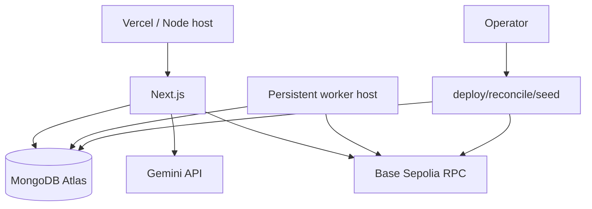

# SmartEscrow — Part 3: Security, Setup, Testing, Limitations

---

## 9. Security and error handling

### 9.1 What is actually implemented

| Control | Implementation | Where |
|---|---|---|
| Wallet authentication | ECDSA signature over address + nonce | `src/lib/auth.ts` |
| Nonce expiry / one-time use | 5-minute store; deleted after successful verify | `auth.ts` |
| Session reuse | 5-minute session keyed by address + nonce + signature | `auth.ts` |
| Sender spoofing prevention | Server overwrites `senderAddress` with verified address | `payments/route.ts` POST |
| Wallet-scoped reads | `getPaymentsBySender(verifiedAddress)` | `payments/route.ts` GET |
| Cross-user update prevention | Loads record and compares `senderAddress` | `payments/route.ts` PATCH |
| Input validation (payments) | Required fields, address regex, positive amount, enums | `payments/route.ts` |
| Input validation (AI) | Manual sanitizer + Zod schema + enums/limits | `parse-payment/route.ts` |
| Address/ENS validation (UI) | Regex/ENS resolution before review | `useENS`, create page |
| Error surfacing | Typed errors, status codes, user-facing messages, toasts | API + hooks + components |
| Contract access control | oracle/executor/sender modifiers and checks | `SmartEscrow.sol` |
| Reentrancy protection | `nonReentrant` + effects before interactions | `SmartEscrow.sol` |
| Contract arithmetic | Solidity 0.8 checked arithmetic | compiler |
| Secrets separation | `DEPLOYER_PRIVATE_KEY` server-only; `.env.local` ignored | config |
| XSS | React escapes rendered strings; no `dangerouslySetInnerHTML` | UI |
| Transport | Same-origin API calls; deploy over HTTPS in production | architecture |

### 9.2 Authentication details (and limits)

- Nonces are **32 hex characters generated with `Math.random`**, not
  `crypto.randomBytes`. Predictability is mitigated by short expiry and
  one-time use, but a CSPRNG is the correct choice.
- Nonce and session stores are **in-process `Map`s**. They reset on restart and
  are not shared across serverless instances or multiple Node processes. A
  load-balanced deployment would fail intermittently; Redis/DB-backed storage is
  required.
- The session allows the same headers to be replayed for up to 5 minutes. This
  is intentional (avoids repeated wallet popups) and is scoped to one address.
- Sessions/nonces are deleted lazily; expired entries can accumulate until
  accessed (minor memory growth).
- `/api/auth/verify` exists but the main flow verifies lazily inside
  `verifyRequestAuth`; both use the same nonce store.

### 9.3 Authorization

- Payments are scoped to the **sender** wallet only. A receiver cannot query a
  payment addressed to them.
- PATCH checks ownership. There is no admin role in the app and no RBAC.
- Contract roles: `oracle` (deployer by default) can release/refund/resolve and
  update roles; `executor` can trigger time-based payouts. Both are single EOAs,
  so the "decentralised oracle" is a trusted operator in this implementation.
- The scheduler signs with `DEPLOYER_PRIVATE_KEY`, which is the oracle/executor
  in the current deployment. Compromise of that key compromises settlement.

### 9.4 Input validation and mass assignment

Payments are validated but **not fully allow-listed**:

```ts
const newPayment: Payment = {
  ...paymentData,
  senderAddress: normalizedSender,
  receiverAddress: normalizedReceiver,
  id: paymentData.id || `pay_${crypto.randomUUID()}`,
  status: paymentData.status || "pending",
  createdAt: paymentData.createdAt || new Date().toISOString(),
};
```

Consequences:
- An authenticated user can choose their own `id` (risk of collisions or
  overwriting assumptions; `savePayment` returns the existing doc instead of
  overwriting, which limits impact).
- They can seed a record directly as `completed` or `active` with no chain
  transaction. The UI's own flow never does this, but the API permits it.
- Unknown extra fields are persisted on Mongo documents (schema `strict` is
  default true for Mongoose **writes through the model**, but `savePayment`
  uses `new model(payment)`; strict mode drops unknown paths there. The JSON
  backend stores them verbatim).

Recommended fix: construct the object field-by-field, force `status:"pending"`,
ignore client `id`/`createdAt`/hash fields on create, and add a schema
allow-list.

### 9.5 AI-specific risks

- `parse-payment` and `chatbot` are **unauthenticated**. Anyone who can reach
  the deployment can spend the Gemini quota. Add auth, rate limiting, and a
  request size cap.
- The parser interpolates the user prompt into the model instruction. Prompt
  injection can influence extraction, but output is constrained by the response
  schema and validated; the user still reviews before signing. Worst case is a
  wrong payment the user must notice.
- The chatbot prompt contains only retrieved PDF context and explicitly refuses
  live wallet/escrow questions. It has no tools and cannot move funds.
- The chatbot returns model text directly into React (escaped by React), so
  script injection is not possible through that path.

### 9.6 API and database security

- No rate limiting despite the README claim. Nonce generation is unlimited.
- No CSRF tokens. The app uses custom `X-Wallet-*` headers and same-origin
  fetches, which makes classic form-based CSRF harder, but not impossible if a
  future endpoint accepts cookies.
- Errors return `error.message` for unexpected failures; stack traces are
  logged server-side. This can leak implementation details.
- Mongo credentials live in `.env.local`; the URI should use a least-privilege
  database user. Atlas network access is IP-restricted (during development the
  current IP had to be whitelisted).
- JSON fallback writes the whole file synchronously. Concurrent requests can
  lose updates and there is no locking; it is a development convenience.
- No field-level encryption; payment metadata is not highly sensitive but is
  readable by anyone with database access.
- No audit log table; the chain provides an immutable event trail.

### 9.7 Smart-contract security review

**Strengths**

- Solidity 0.8.20 overflow checks.
- `nonReentrant` on all settlement functions.
- Checks-effects-interactions ordering in release/refund/recurring.
- Explicit status checks prevent double release/refund.
- ETH transfers use `call` with a success check (no `transfer` gas limit).
- ERC-20 `transfer`/`transferFrom` return values are checked.
- Access modifiers: oracle/executor restrictions; sender-only refund after
  deadline; receiver cannot be the sender.

**Weaknesses / trust assumptions**

1. **Centralised oracle.** The deployer EOA can release or refund any active
   escrow at any time and change the oracle/executor. There is no multisig,
   timelock, or dispute mechanism.
2. **No condition enforcement.** `release` succeeds if the sender calls it,
   regardless of the written condition. Conditions are text; verification is
   social/off-chain.
3. **NFT condition is advisory.** `verifyNFTCondition` is a view function;
   `release` and `resolveEscrow` never call it. An oracle must check it manually.
4. **Recurring escrow is underfunded by design.** Creation deposits `amount`
   once; every payout sends `amount` again. After the first payout the escrow's
   own funds are gone, so later payouts depend on other escrows' balances or
   fail. There is no per-escrow balance accounting.
5. **Recurring never completes on-chain.** Status stays `Active`; only the
   deadline stops further payouts.
6. **Arbitrary ERC-20 accepted.** No token allow-list, no fee-on-transfer or
   rebasing handling. A malicious token can reenter during `transferFrom`
   (creation is not `nonReentrant`).
7. **No pause/emergency stop**, no upgradeability, no fee mechanism.
8. **Deadline default** of 365 days when `duration == 0`.
9. **Not audited.** UI/README wording ("audited smart contracts") is marketing,
   not evidence. Treat it as unaudited student code.
10. Testnet only: Base Sepolia ETH/USDC have no monetary value.

### 9.8 Error-handling map

| Failure | Handling |
|---|---|
| Wallet not installed | `WalletWidget` detects missing `window.ethereum`, offers install link |
| User rejects connection/tx | `describeConnectError` / `parseWalletError` friendly text |
| Wrong network | Widget shows banner and switch button; no automatic switch on write |
| Contract address missing | Create page warning; hook throws before sending |
| Insufficient funds | Mapped message from wallet error |
| Reverted contract call | Mapped message; DB stays pending (create) or unchanged (settle) |
| Receipt has no escrow event | Create page fails loudly and preserves deposit hash |
| PATCH failure after chain tx | Error tells user not to duplicate; reconcile can repair |
| Mongo unreachable (app) | Logs and uses JSON fallback |
| Mongo unreachable (reconcile) | Aborts with explicit error; no fallback write |
| AI missing/quota/bad JSON | Rule-based parser fallback (`mock: true`) |
| Chatbot missing key / empty vectors | `RagError` → HTTP 503 with actionable code |
| `eth_getLogs` range rejection | `/api/events` silently returns empty events (documented limitation) |

---

## 11. Installation, execution, deployment

### 11.1 Prerequisites

- Node.js 18+ (the repo was exercised on Node 22).
- npm.
- MetaMask or another EIP-1193 wallet (or Coinbase Wallet).
- Base Sepolia network (chain id 84532) and faucet ETH for gas/deposits.
- Optional: MongoDB Atlas or local MongoDB.
- Optional: `GEMINI_API_KEY` (without it the parser uses rules and the chatbot
  is disabled).
- Optional: Docker for disposable Mongo tests.

### 11.2 Environment variables

Copy `.env.example` to `.env.local`. Never commit `.env.local`.

| Variable | Required | Used by | Meaning |
|---|---|---|---|
| `NEXT_PUBLIC_SMART_ESCROW_ADDRESS` | after deploy | client, scripts | deployed contract address |
| `NEXT_PUBLIC_BASE_SEPOLIA_CHAIN_ID` | no | docs/config | 84532 |
| `NEXT_PUBLIC_BASE_SEPOLIA_RPC_URL` | no | wagmi, events route | browser/read RPC |
| `BASE_SEPOLIA_RPC_URL` | no | deploy/listener/scheduler/reconcile | server RPC, defaults to public |
| `DEPLOYER_PRIVATE_KEY` | deploy/scheduler | Hardhat, scheduler | testnet-only signer; server-side |
| `MONGODB_URI` | no | db layer | e.g. `.../smartescrow`; without it JSON fallback |
| `GEMINI_API_KEY` | no | parser, RAG | Google AI Studio key |
| `MONGODB_TEST_URI` | no | Mongo tests | dedicated test database |
| `RUN_MONGO_TESTS` | no | Mongo tests | allow using `MONGODB_URI` for tests |
| `LOCAL_DB_PATH` | no | db/seed/tests | alternate JSON file |
| `RECONCILE_MATCH_WINDOW` | no | reconcile | block window for event matching (default 10800) |
| `RECONCILE_LOG_CHUNK` | no | reconcile | log range per request (default 200) |

`.env.local` currently exists with a working Atlas database named `smartescrow`.
Do not print or commit its contents. Rotate any credential that has been shared
in chat or logs.

### 11.3 Install and run

```bash
npm install
npm run dev          # Next dev server, http://localhost:3000
```

First run behavior:
- Without `NEXT_PUBLIC_SMART_ESCROW_ADDRESS`, the create page warns that the
  contract is not deployed.
- Without `MONGODB_URI`, payments go to `src/scratch/db.json`.
- Without `GEMINI_API_KEY`, parsing still works via regex; the chatbot returns
  a configuration error.

### 11.4 Deploy the contract

```bash
npm run deploy
```

`scripts/deploy.ts`:
1. requires `DEPLOYER_PRIVATE_KEY` with `0x`;
2. loads the network/signers from Hardhat;
3. prints address/balance, estimates gas, aborts if insufficient;
4. deploys `SmartEscrow(deployer)`;
5. writes `NEXT_PUBLIC_SMART_ESCROW_ADDRESS` into `.env.local`;
6. tells you to restart the dev server.

Restart `npm run dev` afterward. The contract address is public configuration,
not a secret.

### 11.5 Seed and reconcile

```bash
npm run seed          # local JSON → MongoDB (idempotent)
npm run seed:dry
npm run reconcile     # chain → DB repair
npm run reconcile:dry
```

`seed` requires `MONGODB_URI`; `reconcile` requires it only if it is configured
(then it refuses to fall back).

### 11.6 Background services

```bash
npm run listener      # event sync, Ctrl+C to stop
npm run scheduler     # executes due payments
npm run scheduler:dry # no key/RPC required
```

These must run in a persistent process (VM, container, systemd, PM2). They do
not work as Vercel serverless functions.

### 11.7 Production build

```bash
npm run build
npm start
```

`next.config.ts` enables the React Compiler and marks `pdf-parse` as external.
The build does not run tests.

### 11.8 Deployment architecture (and caveats)



Caveats for serverless hosting:
- in-memory nonce/session stores reset and are per-instance;
- local JSON fallback and RAG writes to `data/` need persistent writable disk;
- the event listener/scheduler need a long-running worker;
- the chatbot/PDF code needs Node runtime (`runtime = "nodejs"` in those routes);
- set a real RPC with adequate `eth_getLogs` limits and HTTPS;
- restrict Atlas network access and use a least-privilege DB user.

### 11.9 Command reference

| Command | What it does |
|---|---|
| `npm run dev` | Next dev server |
| `npm run build` / `start` | production build / serve |
| `npm run deploy` | deploy contract to Base Sepolia |
| `npm run listener` | sync chain events to DB |
| `npm run scheduler` / `scheduler:dry` | execute due escrows / preview |
| `npm run reconcile` / `reconcile:dry` | repair DB from chain / preview |
| `npm run seed` / `seed:dry` | JSON→Mongo import / preview |
| `npm run test:contracts` | 23 Solidity tests |
| `npm run test:e2e` | 3 local-node escrow-id tests |
| `npm run test:security` | 22 auth/ownership tests |
| `npm run test:api` | 15 route-handler tests |
| `npm run test:db` | 8 JSON DB tests |
| `npm run test:db:mongo` | 5 opt-in Mongo tests |
| `npm run test:db:mongo:docker` | disposable Mongo container + tests |
| `npm run test:chatbot` | 7 chatbot API/validation tests |
| `npm run test:chatbot:ui` | 9 widget tests |
| `npm test` | runs all of the above (Mongo skips without URI) |

---

## 12. Testing and limitations

### 12.1 Test suites that exist

| Suite | File | Count | Scope |
|---|---|---|---|
| Contract | `test/SmartEscrow.test.ts` | 23 | deployment, admin, ETH/ERC20, scheduled, recurring, NFT, executor |
| E2E (local node) | `test/e2e.test.ts` | 3 | deploy on Hardhat node, create escrows, decode ids |
| Security | `test/security.test.ts` | 22 | scoping, spoofing, signature, nonce reuse, ownership, validation |
| API | `test/api.test.ts` | 15 | auth, parser, events route |
| JSON DB | `test/db.test.ts` | 8 | save/dedupe/read/update/by escrow id |
| Mongo DB | `test/db.mongo.test.ts` | 5 | same against MongoDB (opt-in) |
| Chatbot API | `test/chatbot.test.ts` | 7 | request validation, config errors, 2 live tests (skipped without key+store) |
| Chatbot UI | `test/chatbot-ui.test.tsx` | 9 | open/send/error/retry flows with mocked fetch |

**Executed and passing during this review:**

```
test:contracts   23 passing
test:e2e          3 passing
test:api         15 passing
test:security    22 passing
test:db           8 passing
test:chatbot:ui   9 passing
```

That is **80 tests verified**. Not run: the 5 MongoDB integration tests (opt-in),
the 7 chatbot API tests (2 would call Gemini), and the aggregated `npm test`.
The README's "71 total" is stale; the current count is 92 including the 5
opt-in Mongo tests.

### 12.2 What the tests do and do not prove

- Contract tests exercise access control, timing, double-settlement, ETH/ERC20
  flows, and receipt behaviour on an in-process Hardhat network.
- E2E proves the app and test share `extractEscrowIdFromLogs` and that ids are
  captured on a real local node.
- Security tests import route handlers directly (no HTTP server) and assert
  wallet scoping, ownership, nonce reuse, invalid signatures, and validation.
- There is **no browser E2E** (no Playwright) and **no coverage report**.
- The recurring underfunding issue is not tested because no test makes a second
  payout beyond the deposited amount.
- The `/api/events` 200-block RPC limit is not covered.
- The chatbot live tests are conditional; a missing key/vector store silently
  skips them.

### 12.3 Known limitations and bugs (honest list)

**Critical / high**

1. **Recurring escrow cannot pay more than its deposit.** Each payout sends
   `escrow.amount` again; there is no decrement or per-escrow accounting.
2. **Recurring is marked completed after the first release.** The listener maps
   any `EscrowReleased` to `completed`, while the chain keeps the escrow active.
   The scheduler then stops because it only reads `active` records.
3. **Default recurring duration is shorter than the interval.** The create page
   defaults `duration` to 86400 s and interval to 30 days. The first payout is
   allowed immediately (`lastRecurringExecution == 0`), but the next payout needs
   30 days while the contract deadline is only 1 day away, so with defaults only
   one payout can ever succeed.
4. **`/api/events` queries 10,000 blocks on a public RPC limited to 200.** The
   catch block hides the error and returns no events.
5. **Recurring/refund status semantics differ.** The chain has `Refunded`; the
   app writes `cancelled`, while `PaymentStatus` also allows `refunded` (which
   renders as Pending in history).
6. **No receiver portal.** Recipients cannot log in to see incoming escrows.

**Medium**

7. In-memory auth/nonce stores; no rate limiting; nonces use `Math.random`.
8. Parser and chatbot endpoints are unauthenticated and uncapped.
9. POST /api/payments allows client-selected id/status/createdAt and extra
   fields.
10. ENS resolution on Base Sepolia is unreliable.
11. Profile shows fake USD volume (`ETH: $3400`); dashboard now shows live ETH.
12. Dashboard "Event Stream" is static sample text.
13. No pagination; every payment is loaded and filtered client-side.
14. JSON fallback has no locking/atomicity.
15. `/api/index-pdf` doesn't index; `indexPDF()` has no caller/script.
16. Duplicate `vector.ts` / `vectorStore.ts`; duplicate `index-pdf`/`test-pdf`.
17. NFT conditions are not enforced by settlement functions.
18. Contract has no pause, upgrade path, token allow-list, or fee handling.
19. The README has outdated function names, token addresses, statuses, and test
    counts; marketing claims of audit/multi-chain/oracle integrations are not
    backed by code.

### 12.4 Future improvements

1. Fund recurring escrows with a total budget and decrement per payout; complete
   when exhausted or deadline reached.
2. Emit a distinct `RecurringPayout` event and keep status active until the
   period ends; update listener/scheduler accordingly.
3. Move nonce/session state to Redis or the database; use `crypto.randomUUID`
   and add rate limiting.
4. Add Zod schemas to all write APIs and a field allow-list; force server-owned
   fields.
5. Add receiver-side views and notifications.
6. Replace the oracle EOA with a multisig/timelock or an actual oracle network;
   enforce NFT/condition checks in settlement.
7. Add token allow-listing and fee-on-transfer handling; add a pause mechanism.
8. Add a proper `/api/events` implementation with chunked `eth_getLogs` or an
   indexer (the reconciliation script already demonstrates chunking).
9. Expose `indexPDF()` via an authenticated admin script/route and version the
   vector store.
10. Add browser E2E tests and coverage; add API rate limits and request size
    caps.
11. Use a real price feed if USD values are shown.
12. Add pagination and server-side filtering.

### 12.5 README vs code — discrepancies to know for a viva

| README claim | Actual code |
|---|---|
| `createConditionalEscrow(...)` | `createEscrow(...)` |
| USDC `0x036CbD53842c54125e4100383a0C066889486Bd1` | `0x036CbD53842c5426634e7929541eC2318f3dCF7e` |
| "Pause" admin function | No pause in contract/tests |
| "Audited smart contracts" | No audit evidence; unaudited student code |
| Event listener sets refunded status | Sets `cancelled` |
| `refunded` lifecycle status | App writes `cancelled` for refunds |
| "71 tests" | 92 current (87 excluding opt-in Mongo); 80 executed here |
| "5+ supported chains" / "Multi-Chain" | wagmi chains: Base Sepolia + localhost; one deployment |
| "Oracles monitor GitHub/deliveries" | No integration; a single oracle address decides |
| Scheduler checks `scheduledAt` in DB | Contract enforces deadline; scheduler filters only type/status/id |
| "Gas under $0.05" | Unverified claim |
| "Event listener monitors... refunded" | It does, but recurring release semantics break |

Use this table to answer "is your README accurate?" honestly: it is aspirational
in places, while the implementation is narrower and testable.
